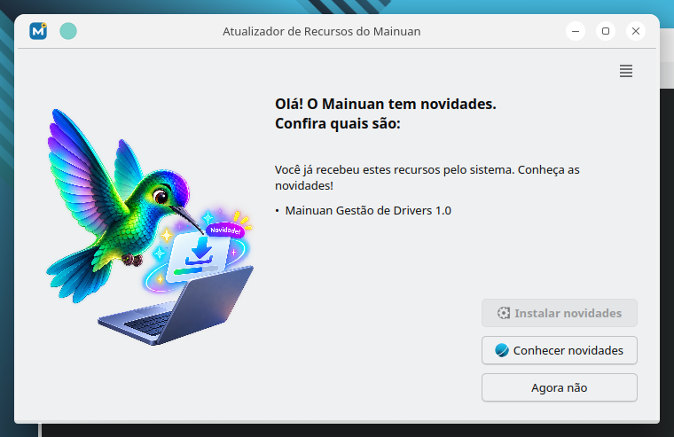

<div align="center">


# Mainuan Feature Updater

Official Mainuan news channel: announces new programs from the organisation and installs them only when the user confirms.

[](https://github.com/mainuan/atualizador-de-recursos/actions/workflows/ci.yml)
[](https://github.com/mainuan/atualizador-de-recursos/releases/latest)
[](LICENSE)


[Português](README.md) · **English**

</div>

---

<p align="center"></p>


## About

The app reads `packages.txt` and `message.txt` from this repository's `main` branch (always from the same commit) and finds the latest stable releases, with a compatible `.deb`, of the official programs listed there. It is not a general APT/Flatpak updater and needs no keys, VM, GitHub App, own APT repository or user configuration.

## Features

- Classic window with **Install New Features**, **Discover What’s New** and **Not Now** (postpones for 24 hours); history and manual check in the menu.
- Background check in the KDE session 60 seconds after login and then hourly; nothing is installed automatically; no checks in the Live session.
- Installation through PackageKit with native PolicyKit authorisation; no password capture.
- Offline: history and cache stay available, installation is blocked.
- Demo mode with fictitious scenarios.

**Channel security:** downloads over HTTPS; size, SHA-256 (the digest published by the GitHub releases API) and the internal `Package`/`Version`/`Architecture` fields are checked; the transaction is simulated and revalidated, and changes outside the announced packages are blocked. HTTPS plus a GitHub digest is **not** equivalent to a signed APT repository, and does not protect against a compromised official GitHub account. See [docs/canal-github.md](docs/canal-github.md) (Portuguese).

## Installation

Preinstalled on the Mainuan ISO. To install manually, download `mainuan-atualizador-recursos_0.2.3_all.deb` and `SHA256SUMS` from the [latest release](https://github.com/mainuan/atualizador-de-recursos/releases/latest):

```bash
sha256sum --check --ignore-missing SHA256SUMS
sudo apt install ./mainuan-atualizador-recursos_0.2.3_all.deb
```

## Usage

`mainuan-atualizador-recursos [--check] [--demo [--scenario NAME]] [--version]`. To announce news, publish a stable release with a `.deb` in the program's repository, add the repository name to `packages.txt` and write the text in `message.txt`. Manual page: `man mainuan-atualizador-recursos`.

## Technical information

| Item | Value |
|---|---|
| Language | Python 3 |
| Toolkit | Qt 6 Widgets (PyQt6) |
| Base | Kubuntu 26.04 LTS, KDE Plasma 6.6 |
| Package | `mainuan-atualizador-recursos` (Debian, `all`, no native code) |

## Build and test

```bash
QT_QPA_PLATFORM=offscreen PYTHONPATH=src python3 -m unittest discover -s tests -v
dpkg-buildpackage -us -uc -b
```

CI: [`.github/workflows/ci.yml`](.github/workflows/ci.yml), on the organisation's shared Debian pipeline.

## Translations

33 languages, English as the source language. See [docs/i18n/README.md](docs/i18n/README.md).

## Contributing

Use [Issues](https://github.com/mainuan/atualizador-de-recursos/issues) and pull requests to `main`.

## Credits

Rafael Ruscher ([@ruscher](https://github.com/ruscher)) and Daigo ([@daigoasuka](https://github.com/daigoasuka)). Based on the TigerOS Feature Updater; original authors are kept in [`debian/copyright`](debian/copyright).

## License

[GPL-3.0](LICENSE).
