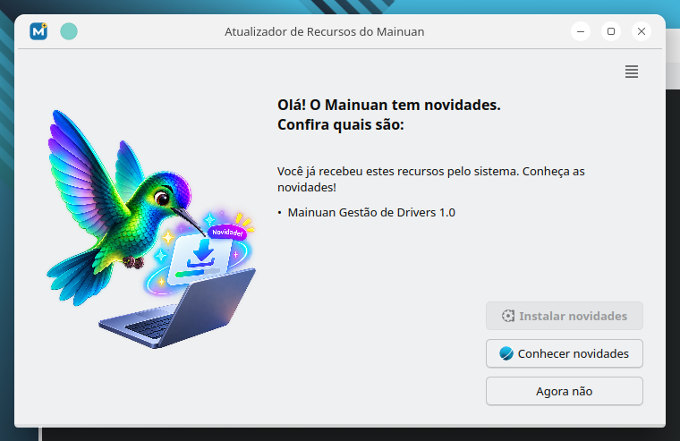

<div align="center">


# Atualizador de Recursos do Mainuan

Canal oficial de novidades do Mainuan: avisa quando há novos programas da organização e os instala só com a confirmação do usuário.

[](https://github.com/mainuan/atualizador-de-recursos/actions/workflows/ci.yml)
[](https://github.com/mainuan/atualizador-de-recursos/releases/latest)
[](LICENSE)


**Português** · [English](README.en.md)

</div>

---

<p align="center"></p>


## O que é

O Atualizador de Recursos consulta, neste repositório, os arquivos `packages.txt` e `message.txt` da `main` (sempre do **mesmo commit**) e descobre as releases estáveis mais recentes, com `.deb` compatível, dos programas oficiais listados. Quando há novidade, mostra a mensagem e oferece instalar.

Não substitui o atualizador geral do sistema (APT/Flatpak). Não exige VM, chave de catálogo, GitHub App, repositório APT próprio nem configuração pelo usuário. O [Mainuan Gestão de Drivers](https://github.com/mainuan/mainuan-gestao-drivers) serviu de referência de arquitetura, sem dependência direta entre os dois aplicativos.

## Funcionalidades

- Interface clássica com o beija-flor e os botões **Instalar novidades**, **Conhecer novidades** e **Agora não** (adia o aviso por 24 horas). Histórico, informações técnicas e verificação manual ficam no menu.
- Verificação em segundo plano durante a sessão KDE: 60 segundos após o login e depois a cada hora. Nada é instalado automaticamente.
- Não consulta nem instala na sessão Live, nem quando não consegue confirmar uma sessão instalada.
- Reconhece versões adequadas já instaladas, inclusive por outra ferramenta, sem reinstalar.
- Instalação pelo PackageKit com autorização nativa do PolicyKit, sem capturar senha.
- Sem conexão, mantém o histórico e o cache para consulta e bloqueia a instalação.
- Modo de demonstração com cenários fictícios, sem rede, APT ou D-Bus.

### Segurança do canal

A consulta inicial baixa só metadados. Ao instalar, o aplicativo:

1. baixa os pacotes por HTTPS e confere tamanho, SHA-256 (o digest publicado pela API de releases do GitHub) e os campos internos `Package`, `Version` e `Architecture`;
2. verifica dependências, simula e revalida a operação antes da autorização do PolicyKit, bloqueando qualquer alteração fora dos pacotes anunciados;
3. só informa sucesso depois de conferir as versões realmente instaladas.

Sem digest verificável, a instalação é bloqueada. O aplicativo registra localmente IDs, commits e digests e rejeita substituição de artefatos e retrocesso de versões já observadas. As dependências precisam estar satisfeitas no sistema.

HTTPS e o digest do GitHub **não equivalem à assinatura de um repositório APT**; as advertências nativas sobre origem não confiável são preservadas. Esses controles não protegem contra o comprometimento da própria conta oficial no GitHub ou do usuário local. Detalhes em [docs/canal-github.md](docs/canal-github.md).

A compatibilidade aceita `ID=mainuan`/`VERSION_ID=2027.1` (RC1 ou final, base Kubuntu 26.04) e as identificações legadas `ubuntu`/`mainuan` com `VERSION_ID` `26.04`/`2026`; recusa `ubuntu/2027.1` e outras versões Ubuntu incompatíveis. Veja as [notas da versão 0.2.3](docs/v0.2.3.md).

## Instalação

O Atualizador de Recursos já vem instalado na ISO do Mainuan. Para instalar manualmente, baixe `mainuan-atualizador-recursos_0.2.3_all.deb` e `SHA256SUMS` da [última release](https://github.com/mainuan/atualizador-de-recursos/releases/latest) e, na pasta dos dois arquivos:

```bash
sha256sum --check --ignore-missing SHA256SUMS
sudo apt install ./mainuan-atualizador-recursos_0.2.3_all.deb
```

O pacote substitui o antigo `feature-update-manager`.

## Uso

Abra **Atualizador de Recursos do Mainuan** no menu de aplicativos (categoria Sistema) ou execute:

```bash
mainuan-atualizador-recursos
```

| Opção | Efeito |
|---|---|
| `--check` | modo da sessão (usado pelo autostart do KDE): verifica após 60 s e a cada hora; mostra novidades não apresentadas ou adiadas há 24 h |
| `--demo` | demonstra o fluxo inteiro com catálogo, pacotes e autorização em memória |
| `--scenario <cenário>` | cenário do `--demo`: `novo`, `visualizado`, `adiado`, `instalado`, `parcial`, `indisponivel`, `incompativel`, `erro` ou `cancelado` |
| `--test-catalog <arquivo>`, `--test-config <arquivo>` | catálogo e configuração de teste; só com `--demo` |
| `--homologacao-github` | ensaio histórico em VM com snapshot; não é necessário no uso normal |
| `--version` | mostra a versão e sai |

O estado, o histórico e o cache ficam em `~/.local/state/mainuan-recursos/` (respeita `XDG_STATE_HOME`). Página de manual: `man mainuan-atualizador-recursos`.

### Publicar novidades

1. Publique uma release **estável** do programa no repositório dele, na organização `mainuan`, com o `.deb` anexado no nome convencional (por exemplo `mainuan-gestao-drivers_1.0_all.deb`). O GitHub precisa informar o digest SHA-256 do asset.
2. Edite [`packages.txt`](packages.txt) pela interface web: um repositório por linha (hoje, `mainuan-gestao-drivers`).
3. Edite [`message.txt`](message.txt): mensagem livre; os parágrafos são preservados.
4. Salve. Não há assinatura, JSON nem versão para editar.

Os nomes amigáveis vêm das releases; *Conhecer novidades* abre a página do primeiro lançamento. Uma nova release estável é descoberta na consulta seguinte, sem recompilar o Atualizador. Não substitua artefatos ou tags já distribuídos: publique uma versão nova. Rotina completa em [docs/canal-github.md](docs/canal-github.md).

## Informações técnicas

| Item | Valor |
|---|---|
| Linguagem | Python 3 |
| Toolkit | Qt 6 Widgets (PyQt6) |
| Base | Kubuntu 26.04 LTS, KDE Plasma 6.6, Wayland |
| Pacote | `mainuan-atualizador-recursos` (Debian, `all`) |
| Dependências principais | `python3-pyqt6`, `python3-apt`, `python3-cryptography`, `packagekit`, `polkitd`; recomenda `polkit-kde-agent-1` |
| Arquitetura | amd64; pacote `all`, sem ELF nem bibliotecas nativas e sem requisito próprio x86-64-v2/v3/v4 |

O teste do conjunto da distribuição num processador x86-64 v1 real ainda está pendente.

O publicador antigo (catálogo Ed25519, repositório APT e GitHub App, em `publish-resources.yml` e `publication.toml`) está desativado; documentos e ferramentas dessa fase são históricos. Veja [docs/canal-github.md](docs/canal-github.md#infraestrutura-histórica) e a [arquitetura](docs/arquitetura.md).

## Compilação e testes

O workflow [CI](.github/workflows/ci.yml) usa o pipeline Debian compartilhado da organização (Ubuntu 26.04 fixado por digest). Equivalente local:

```bash
git clone https://github.com/mainuan/atualizador-de-recursos.git
cd atualizador-de-recursos
sudo apt-get build-dep --no-install-recommends ./

po/i18n.sh check-pot && po/i18n.sh validate
python3 -m compileall -q src bin tools
QT_QPA_PLATFORM=offscreen PYTHONPATH=src python3 -m unittest discover -s tests -v
dpkg-buildpackage -us -uc -b        # repete os testes em dh_auto_test
lintian --fail-on error ../mainuan-atualizador-recursos_0.2.3_all.deb
python3 tools/audit_python_package.py ../mainuan-atualizador-recursos_0.2.3_all.deb --expected-version 0.2.3
```

Para experimentar sem tocar no sistema: `PYTHONPATH=src python3 -m mainuan_recursos --demo`. O script `build-package.sh` gera o pacote em `dist/` sem privilégios administrativos.

O CI também valida as entradas `.desktop` traduzidas, confere o pacote 0.2.1 arquivado em `releases/` e instala, reinstala, remove e expurga o `.deb` num Ubuntu 26.04 limpo. A Release só é publicada por tag `v<versão>` igual à de `debian/changelog` e nunca substitui uma Release existente.

## Traduções

A interface está em 33 idiomas (catálogos em [`po/`](po), inglês como idioma-fonte): ar, bn, cs, da, de, el, es, fa, fi, fr, he, hi, hu, id, it, ja, ko, nb, nl, pl, pt, pt_BR, ro, ru, sv, sw, th, tr, uk, ur, vi, zh_CN e zh_TW.

Como traduzir: [docs/i18n/README.md](docs/i18n/README.md).

## Contribuição

Relate problemas em [Issues](https://github.com/mainuan/atualizador-de-recursos/issues) e envie pull requests para `main`; cada PR passa pelo CI. Para anunciar novidades, basta editar `packages.txt` e `message.txt` (ver [Publicar novidades](#publicar-novidades)).

## Créditos

- **Rafael Ruscher** ([@ruscher](https://github.com/ruscher))
- **Daigo** ([@daigoasuka](https://github.com/daigoasuka))

Baseado no Atualizador de Recursos do **TigerOS**, cujos autores originais estão preservados em [`debian/copyright`](debian/copyright).

## Licença

[GPL-3.0](LICENSE), preservada do projeto original do TigerOS.
